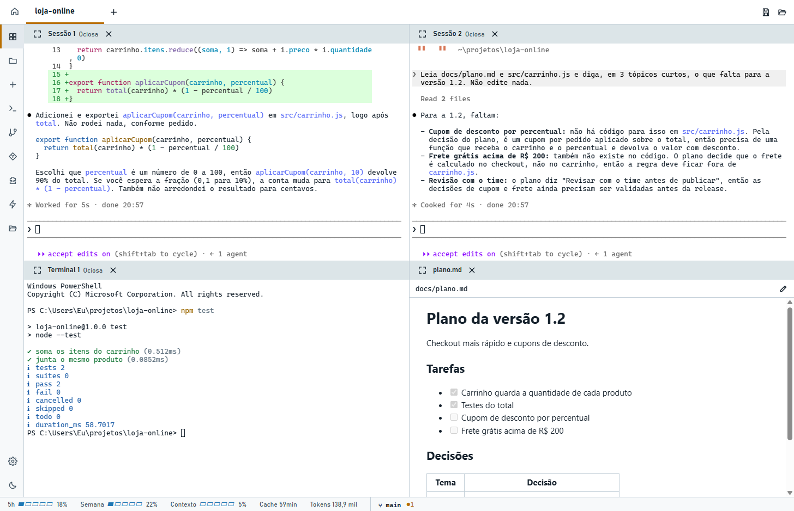
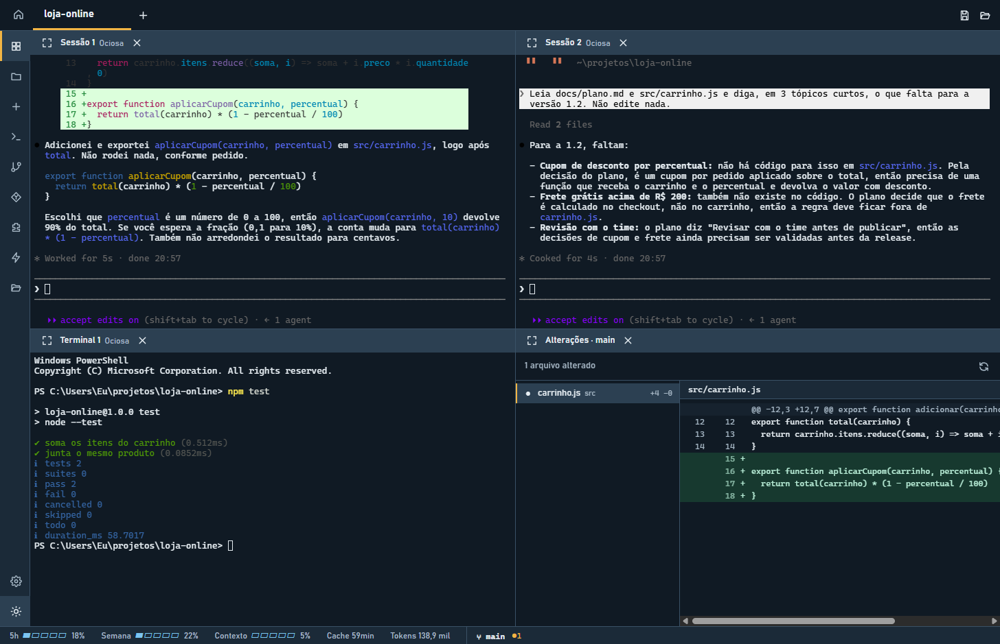

# Agent IDE

**Uma IDE feita para trabalhar com agentes de código, não com um editor.**

Em vez de um editor com um chat ao lado, você monta ambientes de trabalho: várias sessões do
Claude Code em grade, terminais ao lado, um documento aberto para pensar junto com o agente.
Cada sessão é a CLI real do agente rodando em um terminal de verdade: nada é reimplementado,
e tudo o que funciona no seu terminal funciona aqui.

Windows, Linux e Mac (experimental). Open source, licença MIT.

## Principais funções

### Ambientes de trabalho

Cada aba é um ambiente com seus projetos, sessões e layout. Abra quantas sessões do Claude e
terminais quiser, arraste, divida e agrupe os painéis, e destaque uma sessão sem reiniciar nada.
Um ambiente pode reunir vários projetos, e arquivos, Git e sessões novas seguem o projeto da
sessão em uso. [Mais sobre ambientes →](docs/ambientes.md)

### Templates

Salve um ambiente como molde (projetos, quantas sessões e terminais, layout) e abra um igual
com um clique. Exporte para um arquivo e compartilhe com o time: o arquivo leva os projetos
pelo nome, sem conversas, segredos nem caminhos da sua máquina.
[Mais sobre templates →](docs/ambientes.md#templates)

### A IDE volta como estava

Feche o app, ou deixe-o cair, e ele reabre com as mesmas abas, o mesmo layout e as sessões
retomadas, sem continuar sozinhas a tarefa. Uma sessão que trabalhava quando foi encerrada
mostra **Atenção** para você conferir. A sessão segue a conversa depois de `/clear` e `/resume`,
e o histórico de cada projeto lista todas elas. [Mais sobre sessões →](docs/sessoes.md)

### O que importa, à vista

O rodapé mostra o uso do Claude (5 horas e semana), o contexto, o tempo até o cache vencer e os
tokens da sessão em uso, além da branch e das alterações do Git. Um clique no Git troca de
branch ou abre uma sessão numa worktree. Cada indicador pode ser desligado. [Mais sobre o rodapé →](docs/rodape.md)

## Outras funcionalidades

- [Git e worktrees](docs/git.md): troca de branch, pull, push, diff das alterações e sessões em
  worktree, sem nunca forçar nada.
- [Comandos personalizados](docs/comandos-e-plugins.md#comandos): botões que rodam seus comandos
  (`npm run dev`, testes, deploy) em um terminal novo.
- [Plugins do Claude Code](docs/comandos-e-plugins.md#plugins): ative e desative sem sair da IDE.
- [Arquivos e segredos](docs/arquivos-e-segredos.md): árvore do projeto, editor, Markdown ao vivo
  e bloqueio de arquivos como `.env` para o agente.
- [Instalação e atualizações](docs/instalacao.md): detalhes de Linux e Mac, e como a IDE se
  atualiza.
- [Desenvolvimento](docs/desenvolvimento.md): rodar, testar e adaptar a IDE para outras CLIs.

## Instalação

Baixe o instalador do seu sistema na [página de releases](https://github.com/Darci-Jr/agent-ide/releases/latest):

| Sistema | Arquivo |
| --- | --- |
| Windows | `Agent-IDE-Setup-<versão>.exe` |
| Ubuntu e Debian | `.deb` |
| Outras distribuições Linux | `.AppImage` |
| Mac (experimental) | `.dmg` de `arm64` (Apple Silicon) ou `x64` (Intel) |

Os instaladores ainda não são assinados. No Windows, se aparecer "O Windows protegeu o
computador", clique em **Mais informações** e em **Executar assim mesmo**. Para Linux e Mac, veja
[os detalhes de instalação](docs/instalacao.md).

Você precisa do [Claude Code](https://code.claude.com/docs/pt/overview) instalado. Sem ele, a
IDE funciona com terminais comuns e qualquer outra CLI.

## Licença

[MIT](LICENSE)
