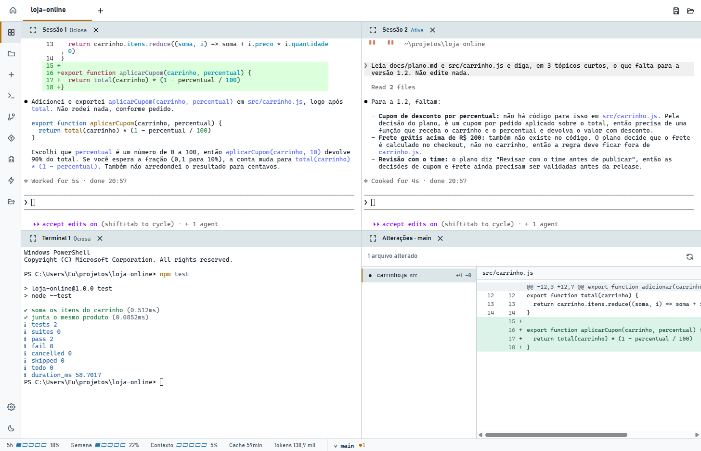

# Git e worktrees

[← Voltar ao início](../README.md)

O ícone Git da barra lateral age sobre o repositório da sessão em uso. Nenhuma ação força nada: o
Git recusa o que perderia trabalho.

## Ações

- **Trocar de branch:** recusado se houver alterações versionadas sem commit.
- **Criar branch** a partir da atual.
- **Buscar** (`fetch --prune`).
- **Pull:** só `--ff-only`, nunca cria merge.
- **Push:** sem forçar; na primeira vez, define o upstream.

## Ver alterações

Abre o painel Alterações: o diff unificado da pasta contra o último commit, juntando o que está em
stage, fora de stage e os arquivos novos. É só leitura. Cada painel guarda a pasta onde abriu, e há
um por pasta.

## Worktrees

A ação **Sessão em worktree** da barra lateral cria uma worktree numa branch nova (`agent/<nome>`),
ao lado do repositório, e abre o Claude nela. Assim, várias sessões trabalham no mesmo repositório sem conflito.

O menu Git lista as worktrees, abre a pasta de cada uma e remove as que não servem mais. Remover
pede confirmação, recusa uma worktree em uso e mantém a branch.

## No rodapé

À direita do rodapé ficam a branch e as alterações da sessão em uso. Clicar nelas abre um menu
curto, com as branches e as worktrees do repositório:

- **Branch:** troca na hora, com as mesmas regras do menu Git. É recusada com alterações
  versionadas e pede confirmação se outras sessões usam a mesma pasta.
- **Worktree:** sempre abre uma sessão nova do Claude nela, inclusive na worktree em que você já está.

Buscar, pull, push, criar branch e ver alterações ficam só no ícone Git da barra lateral. Veja também
[Rodapé](rodape.md).
